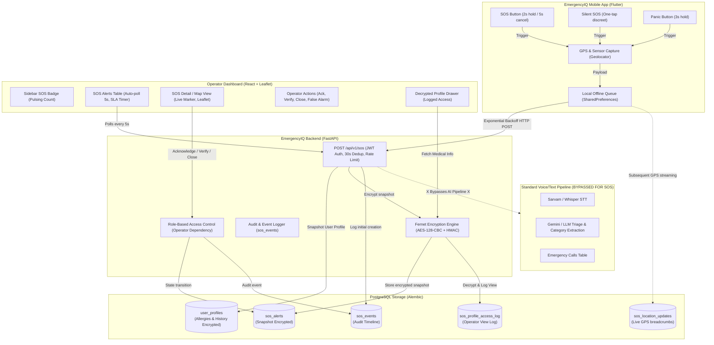

# EmergencyIQ - SOS, Silent SOS & Panic Button Architecture & Feature Guide

## 1. Executive Summary & Core Design Principles

The **EmergencyIQ SOS Suite** introduces a dedicated, high-priority emergency intake pipeline parallel to the standard Voice/Text AI pipeline. It enables citizens to trigger instantaneous distress signals (**Standard SOS**, **Silent SOS**, and **Panic Button**) without requiring any typing or voice interaction during acute emergencies.

### Critical System Rule: AI Bypass for SOS
Unlike voice calls and text reports that flow through STT, LLM extraction, and AI triage classification:
- **SOS is a PARALLEL intake path.**
- It **bypasses the AI analysis pipeline completely** to guarantee sub-second ingestion and prevent hallucinations or AI latency during life-threatening crises.
- Emergency type is designated as `silent_sos` or `unknown_emergency`.
- Every SOS alert is automatically flagged as **`urgent human verification`**.
- It is immediately dispatched to the Operator Dashboard with audio-visual pulsing indicators and SLA tracking countdowns.

---

## 2. End-to-End Data Flow Diagram

---

## 3. Data Dictionary: Fields, Provenance & Encryption

| Field Name | Target Table | Data Origin / Provenance | Encryption Status | Purpose & Description |
| :--- | :--- | :--- | :--- | :--- |
| `id` | `sos_alerts` | Client-generated UUIDv4 | Plaintext (UUID) | Unique primary key for alert tracking |
| `idempotency_key` | `sos_alerts` | Client-generated UUID/Key | Plaintext (Index) | Prevents duplicate alerts on network retries |
| `user_id` | `sos_alerts` | Backend Auth (JWT Token) | Plaintext (FK) | Reference to authenticated citizen user |
| `alert_type` | `sos_alerts` | User UI Selection | Plaintext (Enum) | `sos`, `silent_sos`, or `panic_button` |
| `status` | `sos_alerts` | System / Operator Action | Plaintext (Enum) | `pending`, `acknowledged`, `verified`, `cancelled`, `closed`, `false_alarm` |
| `latitude`, `longitude` | `sos_alerts` / `sos_location_updates` | Device GPS Sensor (`geolocator`) | Plaintext | Coordinate positioning for map dispatch |
| `accuracy_m` | `sos_alerts` / `sos_location_updates` | Device GPS Sensor | Plaintext (Float) | GPS fix precision radius in meters |
| `location_status` | `sos_alerts` | Device Location Manager | Plaintext (Enum) | `available`, `last_known`, `denied`, `unavailable` |
| `triggered_at` | `sos_alerts` | Device Hardware Clock | Plaintext (UTC) | Device timestamp when trigger was engaged |
| `received_at` | `sos_alerts` | Backend Server Clock | Plaintext (UTC) | Authoritative timestamp when alert hit server |
| `battery_pct` | `sos_alerts` | Device Battery Sensor | Plaintext (Int) | Device battery level percentage (0-100) |
| `network_type` | `sos_alerts` | Device Connectivity Manager | Plaintext (String) | Network connection type: `wifi`, `cellular`, `offline` |
| `device_id` | `sos_alerts` | Device Hardware Info | Plaintext (String) | Unique hardware or installation instance ID |
| `app_version` | `sos_alerts` | App Package Config | Plaintext (String) | Application release build version |
| `allergies` | `user_profiles` | User Input (Profile Onboarding) | **Fernet Encrypted** | Critical allergy records (e.g. penicillin, nuts) |
| `medical_history` | `user_profiles` | User Input (Profile Onboarding) | **Fernet Encrypted** | Chronic medical conditions (e.g. asthma, diabetes) |
| `profile_snapshot_encrypted` | `sos_alerts` | Backend Serialization + Encrypt | **Fernet Encrypted** | Immutable copy of user profile & contacts at alert time |
| `medical_consent` | `user_profiles` | User Checkbox Selection | Plaintext (Bool) | Citizen consent for first responders to view medical info |
| `medical_consent_at` | `user_profiles` | Backend Server Clock | Plaintext (UTC) | Timestamp when citizen agreed to emergency consent |

---

## 4. Role-Based Access Control (RBAC) & Visibility Matrix

| Feature / Data Element | Citizen (Self) | Operator | Supervisor / Admin |
| :--- | :---: | :---: | :---: |
| **Trigger SOS / Silent / Panic** | ✅ Yes | ❌ No | ❌ No |
| **View Own Active SOS Status** | ✅ Yes (polling/stream) | ❌ No | ❌ No |
| **Cancel Own SOS with Reason** | ✅ Yes | ❌ No | ❌ No |
| **Stream Live GPS Updates** | ✅ Yes | ❌ No | ❌ No |
| **Edit Own Medical Profile** | ✅ Yes | ❌ No | ❌ No |
| **View All SOS Alerts List** | ❌ 403 Forbidden | ✅ Yes (Real-time table) | ✅ Yes |
| **Acknowledge SOS Alert** | ❌ 403 Forbidden | ✅ Yes | ✅ Yes |
| **Verify Emergency with Caller** | ❌ 403 Forbidden | ✅ Yes | ✅ Yes |
| **Close Alert / False Alarm** | ❌ 403 Forbidden | ✅ Yes | ✅ Yes |
| **Decrypt Medical Profile Snapshot** | ❌ 403 Forbidden | ✅ Yes (Access logged) | ✅ Yes (Access logged) |
| **View Audit Trail & Events** | ❌ 403 Forbidden | ✅ Yes | ✅ Yes |
| **View Global SOS Statistics** | ❌ 403 Forbidden | ✅ Yes | ✅ Yes |

---

## 5. Privacy, Consent & Audit Compliance

### 5.1 Exact In-App Consent Notice
During user profile registration or editing within the Flutter application, users must explicitly review and toggle the medical disclosure consent:

> *"I authorize emergency medical responders and dispatchers to access my medical conditions, allergy history, and emergency contacts solely during active SOS alerts for immediate life-safety care."*

- If consent is unchecked (`false`), medical history and allergies are not included in the decrypted medical snapshot presented to operators.
- `medical_consent_at` records the exact ISO-8601 UTC timestamp of citizen consent.

### 5.2 Encryption at Rest Architecture
- Sensitive health fields (`allergies`, `medical_history`, and the alert `profile_snapshot_encrypted`) are encrypted using **Fernet symmetric encryption** (AES-128 in CBC mode with HMAC-SHA256 authenticated encryption).
- The key is derived from the environment variable `PROFILE_ENCRYPTION_KEY`. The backend will securely fail to start if this key is missing or improperly formatted.
- Database administrators or unauthorized database readers with direct SQL access cannot view medical data in plaintext.

### 5.3 Audit & Access Logging Policy
- Every time an emergency dispatcher/operator opens or views the citizen's medical profile drawer, an immutable row is recorded in `sos_profile_access_log`:
  - `alert_id`: The emergency incident UUID.
  - `operator_id`: The UUID of the authenticated operator.
  - `accessed_at`: Authoritative server UTC timestamp.
- Internal application logs strictly enforce confidentiality: **phone numbers, GPS coordinates, and medical fields are never logged at `INFO` or below levels.**

---

## 6. Known Limitations & Roadmap (Phase 2 & 3)

1. **No SMS / GSM Fallback in Phase 1**:
   - Alerts currently require active HTTP/cellular data or Wi-Fi connectivity. If internet connectivity is completely lost, the mobile app queues the alert locally in `SharedPreferences` with exponential backoff retries until connectivity resumes. SMS fallback via cellular gateway is scheduled for Phase 2.
2. **Lockscreen / Hardware Volume Key Triggers on iOS**:
   - Background hardware key interception (e.g. triple-clicking power or volume buttons while the device is locked) is restricted by Apple iOS sandbox policies. The present version requires opening the EmergencyIQ app or utilizing widget/accessibility shortcuts.
3. **No Direct 112 / PSAP CAD Integration**:
   - SOS alerts currently route directly into the EmergencyIQ Operator Command Dashboard. Forwarding directly to national PSAP CAD (Computer-Aided Dispatch) via CAP (Common Alerting Protocol) or standard 112 interfaces will be deployed in subsequent enterprise integrations.

---

## 7. Home Screen, Service Categories, TrackMe & Contacts Extension

### 7.1 New Database Tables & Columns
- **`sos_alerts` Extensions**:
  - `service_category` (`general`, `police`, `fire`, `medical`, `disaster`, `women`, `child`, `elderly`, `railway`; default `general`).
  - `category_source` (`user_selected`; default `user_selected`). Never fed into the AI analysis or rule engine, and never overwritten.
- **`emergency_contacts`**: Up to 5 personal contacts per citizen (`name`, `phone`, `relation`, `notify_on_sos`, `is_primary`).
- **`user_notifications`**: Citizen alerts generated on operator status changes (`alert_acknowledged`, `alert_verified`, `alert_closed`, `alert_false_alarm`, `alert_cancelled`, `track_expired`). Contains no medical data or exact coordinates.
- **`track_sessions` & `track_points`**: Timed live location sharing sessions (`1, 2, 4, 8, 12` hours) with unguessable `share_token` (`secrets.token_urlsafe(32)`).

### 7.2 New Backend Endpoints
- `GET /api/v1/sos/mine` & `GET /api/v1/sos/mine/{id}` (citizen history & user-visible timeline; no medical data).
- `GET/POST/PUT/DELETE /api/v1/users/me/emergency-contacts` (max 5, Indian phone normalization).
- `GET /api/v1/users/me/notifications`, `/unread-count`, `POST .../read`, `POST .../read-all`.
- `POST /api/v1/track/start`, `POST /api/v1/track/{id}/points`, `POST /api/v1/track/{id}/stop`, `GET /api/v1/track/{id}`.
- `GET /api/v1/public/track/{token}` (public read-only, rate limited, returns only `first_name`, `status`, `last_position`, `updated_at`, `expires_at`).
- `GET /api/v1/location/reverse?lat&lon` (rate-limited wrapper around `location_service.reverse_geocode`).

### 7.3 Flutter App Screens & Localization
- **112-Style Home Screen & Drawer**: 4x2 shortcut grid, 4x2 service tiles (`Police 100`, `Fire 101`, `Medical 108`, `Disaster 1070`, `Woman 181`, `Child 1098`, `Elderly 14567`, `Railway 139`), integrated helpline dialog, and cached reverse-geocoded location bar.
- **New Screens**: `EContactScreen`, `SosHistoryScreen`, `SosHistoryDetailScreen`, `NotificationsScreen`, `TrackMeScreen`, `SettingsScreen`, `AppInfoScreen`, `TopQuestionsScreen`, `AboutUsScreen`.
- **Localization**: `flutter_localizations` + ARB files for `en`, `hi`, `gu`, and `mr` (`hi`/`gu`/`mr` marked `needs native review`).

### 7.4 Known Limits (Extended Phase)
- **No SMS Gateway**: Emergency contacts are displayed to operators and TrackMe links are shared via `share_plus` or user-initiated `sms:` intents; no automated SMS gateway is integrated.
- **No Two-Way Chat Yet**: The "Chat Us" shortcut displays a clear "coming soon" notice and focuses the existing typed emergency report field.
- **No Official 112 Integration**: "Dial 112" opens the native phone dialer after confirmation and never auto-calls; server receipt is not confirmation of official dispatch.
- **Push Notifications**: Uses 15-second polling while open; Firebase Cloud Messaging push is omitted because `firebase_messaging` is not configured in the repository.

---

## 8. Phases A–D Security, Real-Time WebSocket & End-to-End Architecture

- **Authentication & RBAC (Phase A)**:
  - Access tokens (30m) + rotating refresh tokens (7d, SHA-256 hashed in `refresh_tokens`).
  - Logout and password change/admin reset revoke refresh tokens in PostgreSQL.
  - Account + IP exponential lockout after 5 failed logins; CORS allowlist from `ALLOWED_ORIGINS` (no wildcard with credentials).
  - Flutter stores tokens in `flutter_secure_storage` with a 401 refresh-and-retry interceptor (`AuthHttpClient`).
  - Dashboard enforces role-based routes (`Operator`/`Supervisor`/`Admin`, Admin-only `/admin/*`), 30-minute inactivity auto-logout with 1-minute warning, and `/unauthorized` 403 handling.
- **End-to-End Data Flow (Phase B)**:
  - Voice/text emergency reports attach `user_id` from JWT and link to `UserDetailPage` (`/users/:id`).
  - Dashboard KPI cards include `Active SOS`, `Silent SOS`, `Panic Button`, `Pending Verification`, and `TrackMe Active` (separate from `Total Calls`).
  - All timestamps stored in UTC and formatted in **IST (`Asia/Kolkata`)** across Flutter and React.
- **Real-Time TrackMe & Operator WebSocket (Phases C & D)**:
  - `WS /ws/operator` (JWT-authenticated for operators/supervisors/admins) broadcasts `sos.created`, `sos.updated`, `sos.cancelled`, `track.updated`, and `report.created` in `<2s`, with exponential backoff reconnect and 5s polling fallback on the dashboard.
  - TrackMe supports Android foreground location service, battery-aware 15-30s intervals, offline point buffering with `client_point_id` deduplication, SOS auto-attachment, and operator `LiveTrackingPage` (`/live-tracking`) with audit logging.

